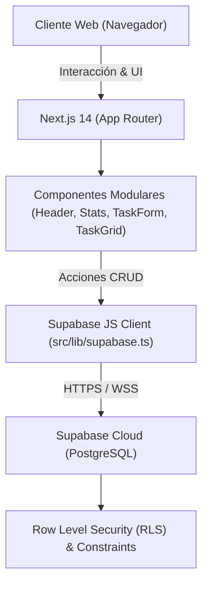

# UNAD DevTrack - Plataforma de Trazabilidad Curricular y Proyectos

<div align="center">


**Plataforma de alta fidelidad para el seguimiento de tareas, actividades curriculares y proyectos de ingeniería de la Universidad Nacional Abierta y a Distancia (UNAD).**

[Características](#-características-principales) •
[Arquitectura Técnica](#-arquitectura-técnica) •
[Seguridad y Cumplimiento](#-seguridad-y-cumplimiento-normativo) •
[Inicio Rápido](#-guía-de-ejecución-local) •
[Base de Datos](#-esquema-de-base-de-datos)

</div>

---

## 🚀 Características Principales

* **Tablero de Control Dinámico:** Gestión visual en tiempo real de actividades curriculares con filtrado por estado (`pendiente`, `en_progreso`, `completada`) y búsqueda instantánea.
* **Estética Glassmorphism Premium:** Interfaz oscura adaptada a la identidad institucional UNAD (azul marino `#005691` y ámbar dorado `#f39200`) con desenfoque de fondo y acentos luminosos.
* **Microinteracciones y Animaciones Fluidas:** Transiciones suaves con `framer-motion` (elevación en hover, feedback táctil en clics y staggered animation al montar).
* **Validación Obligatoria de Habeas Data:** Checkbox interactivo que audita el consentimiento informado bajo la **Ley 1581 de 2012** antes de persistir cualquier registro.
* **Celebración y Feedback Háptico:** Ráfaga de confeti con `canvas-confetti` y toast flotante al registrar satisfactoriamente una actividad académica.

---

## 🛠️ Arquitectura Técnica



* **Frontend Framework:** Next.js 14 (App Router) con arquitectura modular basada en componentes.
* **Lenguaje:** TypeScript 5 con tipado estricto de extremo a extremo.
* **Estilos:** Tailwind CSS con paleta institucional UNAD y efectos Glassmorphism personalizados.
* **Animaciones:** Framer Motion y Canvas Confetti.
* **Base de Datos & Backend:** Supabase (PostgreSQL relacional) con políticas de seguridad a nivel de fila (**RLS**).
* **Despliegue Recomendado:** Vercel / Netlify con CI/CD automatizado.

---

## 🛡️ Seguridad y Cumplimiento Normativo

### 1. Ley Estatutaria 1581 de 2012 (Habeas Data de Colombia)
El sistema implementa una compuerta obligatoria de consentimiento:
* **Frontend:** El formulario bloquea el envío y despliega advertencias pedagógicas si el checkbox de consentimiento de datos personales no es autorizado voluntariamente por el estudiante.
* **Capa de Servicios:** `src/lib/supabase.ts` valida en la función `createTask` que `data_consent === true` antes de enviar la instrucción `INSERT`.
* **Capa de Base de Datos:** Restricción a nivel de base de datos (`WITH CHECK (data_consent = true)`).

### 2. Row Level Security (RLS)
La tabla `unad_tasks` en PostgreSQL cuenta con RLS activado:
* **Lectura Segura:** Políticas configuradas para permitir la trazabilidad pública de actividades formativas.
* **Inserción Condicionada:** Exige que el consentimiento esté marcado afirmativamente.
* **Aislamiento de Claves:** Las credenciales privilegiadas (`SUPABASE_SERVICE_ROLE_KEY`) están confinadas al servidor y nunca se exponen al bundle del cliente.

---

## 💻 Guía de Ejecución Local

### Prerrequisitos
* Node.js v18.18+ o v20+
* Administrador de paquetes `npm`, `pnpm` o `yarn`
* Una instancia de proyecto en [Supabase](https://supabase.com)

### 1. Clonar el Repositorio
```bash
git clone https://github.com/jhonzapata2020/devstack.git
cd devstack
```

### 2. Instalar Dependencias
```bash
npm install
```

### 3. Configurar Variables de Entorno
Crea un archivo `.env.local` en la raíz del proyecto basándote en la plantilla `.env.example`:

```bash
cp .env.example .env.local
```

Edita `.env.local` con las claves de tu proyecto de Supabase:
```env
NEXT_PUBLIC_SUPABASE_URL=https://tu-proyecto.supabase.co
NEXT_PUBLIC_SUPABASE_ANON_KEY=tu_publishable_anon_key_aqui
```

> [!WARNING]
> Nunca subas el archivo `.env.local` a Git. Este archivo ya se encuentra estrictamente ignorado en `.gitignore`.

### 4. Inicializar la Base de Datos
Ejecuta el script SQL ubicado en `supabase/schema.sql` directamente en el **SQL Editor** de tu consola de Supabase.

### 5. Iniciar el Servidor de Desarrollo
```bash
npm run dev
```

Abre [http://localhost:3000](http://localhost:3000) en tu navegador para ver la aplicación en ejecución.

### 6. Compilar para Producción
```bash
npm run build
npm run start
```

---

## 🗄️ Esquema de Base de Datos

```sql
CREATE TABLE IF NOT EXISTS public.unad_tasks (
  id UUID PRIMARY KEY DEFAULT gen_random_uuid(),
  title TEXT NOT NULL,
  student_name TEXT NOT NULL,
  category TEXT NOT NULL DEFAULT 'Ingeniería de Software',
  status TEXT NOT NULL DEFAULT 'pendiente' CHECK (status IN ('pendiente', 'en_progreso', 'completada')),
  priority TEXT NOT NULL DEFAULT 'media' CHECK (priority IN ('baja', 'media', 'alta', 'urgente')),
  data_consent BOOLEAN NOT NULL DEFAULT false,
  created_at TIMESTAMP WITH TIME ZONE DEFAULT timezone('utc'::text, now()) NOT NULL
);
```

---

## 👥 Equipo y Licencia

Desarrollado para la **Escuela de Ciencias Básicas, Tecnología e Ingeniería (ECBTI)** de la **Universidad Nacional Abierta y a Distancia (UNAD)**.

Distribuido bajo la Licencia MIT. Consulta el archivo `LICENSE` para más información.
